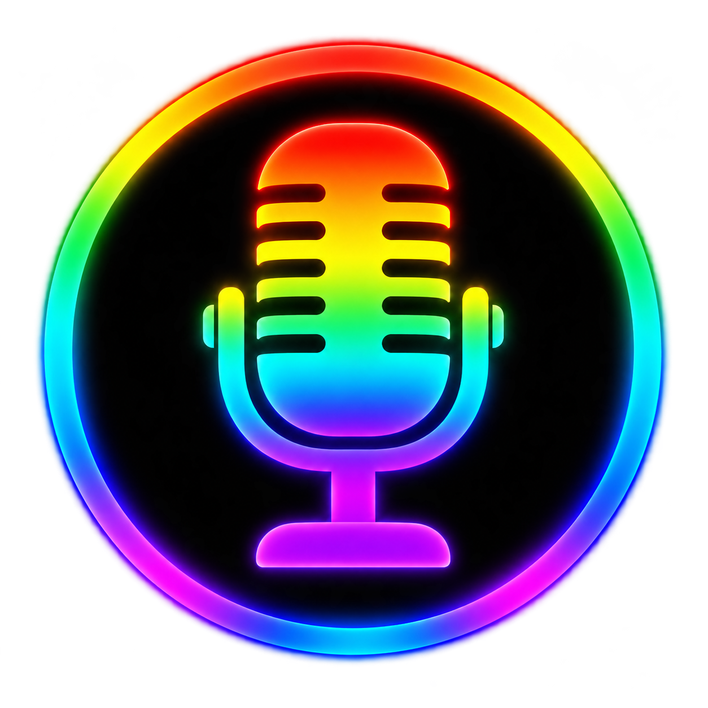
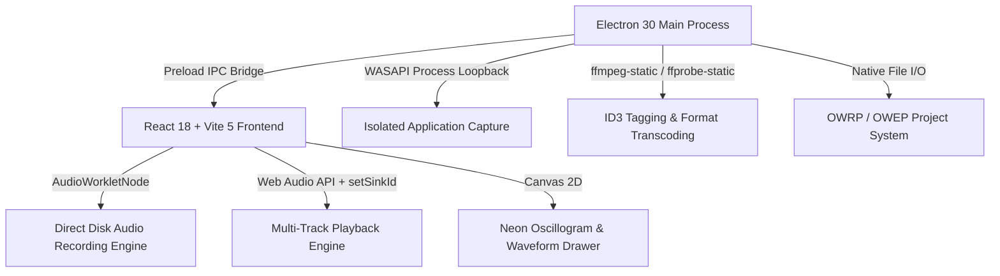

<p align="center">
  
</p>

<h3 align="center">Lean, High-Performance Multitrack Audio Recorder, WASAPI Process Loopback & Retro Focus Studio</h3>

<p align="center">
  <a href="#english">English Documentation</a> • 
  <a href="#deutsch">Deutsche Dokumentation</a> • 
  <a href="CHANGELOG.md">Changelog</a> • 
  <a href="https://github.com/OmegaProjct/Omega-Wave-Recorder/releases/latest">Releases</a>
</p>

<p align="center">
  <a href="https://github.com/OmegaProjct/Omega-Wave-Recorder/releases/latest"></a>
  
  
  
  <a href="LICENSE"></a>
</p>

---

## 📑 Table of Contents / Inhaltsverzeichnis

| 🇬🇧 English | 🇩🇪 Deutsch |
| :--- | :--- |
| ⚡ [Quick Download](#quick-download) | ⚡ [Schnelldownload](#schnelldownload) |
| 🌟 [Core Features](#en-core-features) | 🌟 [Hauptfunktionen](#de-hauptfunktionen) |
| 🎛️ [Hybrid Interface](#en-hybrid-ui) | 🎛️ [Hybrid-Benutzeroberfläche](#de-hybrid-ui) |
| 🛠️ [Architecture & Tech Stack](#en-tech-stack) | 🛠️ [Architektur & Tech-Stack](#de-tech-stack) |
| 🔄 [OWE Compatibility](#en-compatibility) | 🔄 [OWE-Kompatibilität](#de-kompatibilitaet) |
| 💻 [Development & Setup](#en-development) | 💻 [Entwicklung & Setup](#de-entwicklung) |
| 📜 [Changelog](CHANGELOG.md) | 📜 [Changelog](CHANGELOG.md) |
| ❤️ [Support the Project](#en-support) | ❤️ [Projekt unterstützen](#de-support) |

---

<a name="quick-download"></a>
<a name="schnelldownload"></a>
## ⚡ Quick Download / Schnelldownload

Get the latest stable release of **Omega Wave Recorder** directly from our [Releases Page](https://github.com/OmegaProjct/Omega-Wave-Recorder/releases/latest):

| Operating System | Recommended Installer | Standalone / Portable |
| :--- | :--- | :--- |
| **🪟 Windows 10 / 11** (x64) | [**Download Setup (.exe)**](https://github.com/OmegaProjct/Omega-Wave-Recorder/releases/latest/download/Omega-Wave-Recorder-Setup-0.1.2.exe) | [**Download Portable (.exe)**](https://github.com/OmegaProjct/Omega-Wave-Recorder/releases/latest/download/Omega-Wave-Recorder-Portable-0.1.2.exe) |

---

<a name="english"></a>
# 🇬🇧 English Documentation

**Omega Wave Recorder** is a lean, ultra-responsive multitrack audio recorder for Windows, built as part of the **Omega Media Core** suite. Combining modern 4-track parallel and punch-in recording with isolated application audio capture (WASAPI Process Loopback) and a nostalgic single-track focus view inspired by classic Windows Sound Recorder (`sndrec32.exe`).

---

<a name="en-core-features"></a>
## 🌟 Core Features

### 1. Dual-Source Audio Capture
- **Hardware & Line-In Inputs:** Studio-grade 32-bit float PCM recording from physical microphones, line-in interfaces, and audio devices (USB interfaces, Voicemeeter, Stereo Mix).
- **Application Process Loopback:** Capture individual Windows applications (e.g., Spotify, Discord, games, browser streams) in clean, isolated audio streams without capturing system notifications, discord beeps, or unwanted sounds.

### 2. Multi-Track & Punch-In Recording
- **Up to 4 Parallel Tracks:** Record up to 4 tracks simultaneously, or record selectively on armed tracks for seamless overdubbing and punch-ins.
- **Direct-to-Disk Streaming:** Audio chunks stream continuously to disk via Electron IPC to eliminate RAM bloat during long recording sessions.
- **Hardware-Accelerated VU Meters:** Real-time peak meters (-60 to 0 dBFS) with green/yellow/red gradient level indication.

### 3. Dynamic Output Monitoring
- **Real-Time Sink Selection:** Switch master output routing on the fly via Web Audio `AudioContext.setSinkId` (System Default, Headphones, Studio Monitors, Speakers).

### 4. Smart Cutting & Mini-Editor
- **Synchronized Time Ruler:** Drag In/Out ranges across the time ruler to cut all tracks synchronously, or select a single track for isolated cutting.
- **Seamless Micro-Fades:** Automated 3ms anti-click micro-crossfades on cut edges prevent audible pops or clicks.
- **Fast Trim Tools:** One-click *Delete Before Playhead* and *Delete After Playhead* for rapid vocal and clip trimming.
- **50-Step Undo/Redo:** Full non-destructive snapshot history for all trimming, cutting, and track operations.

### 5. High-Resolution ID3v2 & Cover Art Export
- **Export Options:** Master sum mixdown or separate track stems to WAV, MP3 (`libmp3lame`), and OGG (`libvorbis`).
- **Full ID3 Tag Editor:** Embed Title, Artist, Album, Year, Genre, Track number, Comments, and Cover Art into exported audio files.

---

<a name="en-hybrid-ui"></a>
## 🎛️ Hybrid Interface: Multi-Track vs. Retro Focus View

Omega Wave Recorder features a one-click toggle in the title bar:
1. **Multi-Track Grid View:** Modern 4-track stack with individual track lanes, volume sliders, mute/solo buttons, and input selector dropdowns.
2. **Retro Single-Track Focus View:** Maximized vintage oscilloscope display featuring a glowing neon-green (`#00ff66`) dynamic waveform line reminiscent of the classic Windows WAV-Recorder.

---

<a name="en-tech-stack"></a>
## 🛠️ Architecture & Tech Stack



- **Frontend:** React 18, TypeScript, Tailwind CSS, Lucide Icons, i18next (DE/EN + user-extensible Locales).
- **Backend & Native:** Electron 30, Node.js, `fluent-ffmpeg`, `desktopCapturer` / WASAPI Loopback.
- **CI/CD:** Automated GitHub Actions multi-stage release pipeline with NSIS installer and Portable builds.

---

<a name="en-compatibility"></a>
## 🔄 Omega Wave Editor (OWE) Compatibility

Projects saved in Omega Wave Recorder (`.owrp`) share the **exact same JSON project schema** as the **Omega Wave Editor** (`.owep`). You can record quick ideas or live multitrack sessions in OWR and immediately open the `.owrp` project inside Omega Wave Editor for advanced multi-band DSP mastering, VST plugin hosting, and automation.

---

<a name="en-development"></a>
## 💻 Development & Setup

### Prerequisites
- **Node.js** (v20 or higher recommended)
- **npm** (v10 or higher)

### Setup & Commands
```bash
# Clone the repository
git clone https://github.com/OmegaProjct/Omega-Wave-Recorder.git
cd Omega-Wave-Recorder

# Install dependencies
npm install

# Start development mode
npm run dev

# Check TypeScript type safety
npm run typecheck

# Run test suite
npm test

# Build production bundle
npm run build

# Package local Windows installer & portable binaries
npm run dist
```

---

<a name="deutsch"></a>
# 🇩🇪 Deutsche Dokumentation

**Omega Wave Recorder** ist ein schlanker, performanter Mehrspur-Audiorekorder für Windows innerhalb der **Omega Media Core** Suite. Er vereint moderne 4-Spur-Parallel- und Punch-in-Aufnahmen, isolierte Programm-Audioaufzeichnung (WASAPI Process Loopback) und eine nostalgische Einzelspur-Fokusansicht im Stil des klassischen Windows WAV-Recorders (`sndrec32.exe`).

---

<a name="de-hauptfunktionen"></a>
## 🌟 Hauptfunktionen

### 1. Duale Audioaufnahme (Hardware & Programme)
- **Hardware- & Line-In Eingänge:** Kristallklare 32-Bit Float PCM Aufnahme über Mikrofone, Interfaces und Audiogeräte (USB-Interfaces, Voicemeeter, Stereo Mix).
- **Windows Core Audio Loopback:** Isoliertes Abgreifen einzelner Windows-Programme (z. B. Spotify, Discord, Spiele, Browser) ohne Störgeräusche von Systemsounds oder Windows-Meldungen.

### 2. Mehrspur- & Punch-In Recording
- **Bis zu 4 parallele Spuren:** Parallele Aufnahme auf mehreren Spuren gleichzeitig oder gezielte Einzelaufnahme auf scharfgeschalteten Spuren für Overdubs.
- **Direct-to-Disk Streaming:** Kontinuierliches Schreiben der Audio-Chunks auf die Festplatte zur Vermeidung von Speicherüberläufen bei langen Aufnahmesitzungen.
- **Hardware-optimierte VU-Meter:** Echtzeit Stereo-Peak-Pegelanzeigen (-60 bis 0 dBFS) mit dreifarbigem Pegelverlauf.

### 3. Dynamische Audioausgangs-Wahl
- **Unterbrechungsfreier Wechsel:** Sofortiges Umschalten des Abhörgeräts (Systemstandard, Kopfhörer, Boxen) direkt über das Web Audio `AudioContext.setSinkId` Dropdown in der Transportleiste.

### 4. Smart-Cutting & Mini-Editor
- **Synchroner Time Ruler:** Synchrones Schneiden aller Spuren über den Time Ruler oder isolierter Schnitt einer ausgewählten Spur.
- **Klickfreie Micro-Fades:** Automatische 3ms Micro-Crossfades an Schnittkanten verhindern Knacken.
- **Schnelltrimmer:** *Davor löschen* und *Danach löschen* per Klick für schnelles Bereinigen von Takes.
- **50-stufiges Undo/Redo:** Vollständige Snapshot-Historie für alle Schnitt- und Bearbeitungsschritte.

### 5. High-End Export mit ID3v2-Tags & Cover-Art
- **Exportformate:** Summen-Mixdown oder getrennte Einzelspuren (Stems) nach WAV, MP3 (`libmp3lame`) und OGG (`libvorbis`).
- **Vollwertiger ID3-Editor:** Titel, Artist, Album, Jahr, Genre, Tracknummer, Kommentare und Albumcover direkt in die Datei einbetten.

---

<a name="de-hybrid-ui"></a>
## 🎛️ Hybrid-Benutzeroberfläche

Über den Umschalter in der Titelleiste kann jederzeit zwischen zwei Ansichten gewechselt werden:
1. **Multi-Track Grid-Ansicht:** Übersichtliche 4-Spur-Stapelung mit Lautstärkereglern, Mute/Solo, Pegelanzeigen und Quellen-Dropdowns.
2. **Retro-Einzelspur-Fokusansicht:** Große Oszilloskop-Darstellung mit pulsierender, neongrüner Signallinie (`#00ff66`) im Look des legendären Windows-Audiorecorders.

---

<a name="de-kompatibilitaet"></a>
## 🔄 Kompatibilität zum Omega Wave Editor (OWE)

Projektdateien (`.owrp`) verwenden exakt dasselbe Datenmodell wie der **Omega Wave Editor** (`.owep`). In OWR aufgenommene Spuren können direkt im Omega Wave Editor geöffnet werden, um VST-Plugins, Multiband-Equalizer, Dynamic-Kompressoren und Mastering-Tools zu nutzen.

---

<a name="de-tech-stack"></a>
## 🛠️ Technologie & Architektur

- **Frontend:** React 18, TypeScript, Tailwind CSS, Lucide Icons, i18next.
- **Backend:** Electron 30, Node.js, `fluent-ffmpeg`, WASAPI Process Loopback.
- **CI/CD:** GitHub Actions Release-Pipeline mit automatischem NSIS-Setup und Portable-Builds.

---

<a name="de-entwicklung"></a>
## 💻 Entwicklung & Setup

```bash
# Repository klonen
git clone https://github.com/OmegaProjct/Omega-Wave-Recorder.git
cd Omega-Wave-Recorder

# Pakete installieren
npm install

# Entwicklungsserver starten
npm run dev

# TypeScript-Typencheck
npm run typecheck

# Automatische Tests ausführen
npm test

# Produktions-Bundle kompilieren
npm run build

# Lokales Windows-Installationsprogramm packen
npm run dist
```

---

<a name="en-support"></a>
<a name="de-support"></a>
## ❤️ Support the Project / Projekt unterstützen

Wenn dir der **Omega Wave Recorder** gefällt, kannst du die Weiterentwicklung gerne unterstützen:
- [**PayPal Spende**](https://paypal.me/omega1337)
- Starte das Repository mit einem ⭐ auf GitHub!

---

## 📜 Lizenz
Dieses Projekt steht unter der **MIT-Lizenz**. Siehe [LICENSE](LICENSE) für Details.

© 2026 Omega Projects. Alle Rechte vorbehalten.
